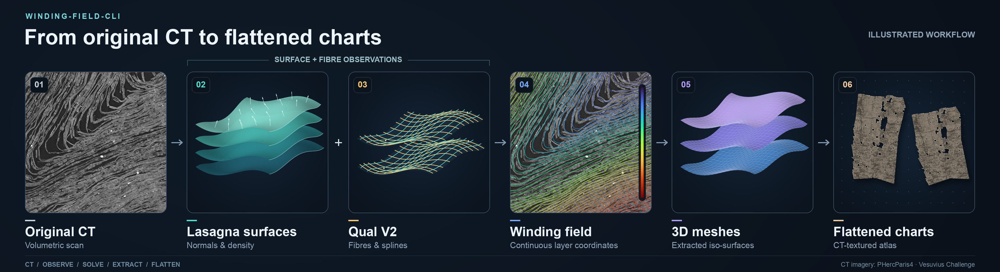

# winding-field-cli

[](https://github.com/LimeGS/winding-field-cli/actions/workflows/tests.yml)
[](#checks)
[](LICENSE)
[](pyproject.toml)
[](https://github.com/LimeGS/winding-field-cli/releases)



Build a winding field from scroll CT, then extract meshes and CT-textured surfaces.
Defaults: Lasagna surface observations, Qual V2 fibres/splines and native surfaces
flattened with Flatboi SLIM. Saved stages let you stop and continue later.

Start with **1 → 2 → 4**: install, run the demo, then a small region. Use **3**
for a full scroll only when its plan fits your resources; **5** resumes work,
**6** exports surfaces, **7** reuses existing inputs, **8** summarizes options and
results, and **9** links to the detailed guides.

<details>
<summary><strong>1. Install</strong></summary>

Install once with `wf`, then use `wf` in place of `winding-field` in every command
of this README. **Docker is the default**: the image contains the complete CLI,
Lasagna, native Flatboi (SLIM) and prebuilt accelerators, with no host Python or
system packages to manage.

### 1A. Install with `wf` (default)

**1. Get `wf`:**

```bash
git clone https://github.com/LimeGS/winding-field-cli.git
echo "export PATH=\"$PWD/winding-field-cli/tools:\$PATH\"" >> ~/.bashrc && source ~/.bashrc
```

**2. Install** with Docker (needs Linux x86-64 and Docker with Compose; for GPUs
also the NVIDIA Container Toolkit):

```bash
wf docker-install
```

This picks GPU or CPU automatically and checks the image. The CPU image is
downloaded from [GHCR](https://github.com/LimeGS/winding-field-cli/pkgs/container/winding-field-cli)
(`ghcr.io/limegs/winding-field-cli`), the build `main` published for your exact commit;
a GPU image, local changes or an unpublished commit are built from the checkout
instead (`WF_BUILD=1` always builds). Each release also publishes a GPU image you can
run directly, without the checkout: see [Published image](docs/DOCKER.md#published-image). Without Docker, run `wf native-install`
instead: it installs on the host (Ubuntu 24.04, uses `sudo` for system packages)
and the same `wf` commands keep working.

Options and details: [CPU and CUDA containers](docs/DOCKER.md).

<details>
<summary><strong>1B. Manual host install</strong> (development)</summary>

Installs the CLI directly on the host. Both variants use the same dependencies
and automatic CPU/CUDA selection. Prebuilt accelerators are not included, and on
Linux x86_64 the pinned Flatboi (SLIM) runtime is downloaded and hash-verified on
first use (`--offline` disables that download; see
[SLIM runtime](docs/FLATTENING.md#slim-runtime-flatboi)).

`wf native-install` runs the quick install below for its checkout. If you
install manually instead, run the commands in this README with `winding-field` in
place of `wf`, and host paths in place of `/data/...` and `/outputs/...`.

#### Quick install

On **Ubuntu 24.04** with `curl` available, run this in **Bash** from the directory
where you want the checkout:

```bash
source <(script=$(curl -fsSL https://raw.githubusercontent.com/LimeGS/winding-field-cli/main/tools/install.sh) && printf '%s\n' "$script" || printf 'return 1\n')
```

The [installer](tools/install.sh) uses `sudo` for system packages (unless root),
clones into `./winding-field-cli`, creates the CLI and isolated Lasagna environments,
and runs `doctor`, then activates the CLI in this shell. Rerun from the same parent
directory to reuse them. It does not pull updates, reset local edits, download
models or create demo outputs; unrelated
directories and incomplete environments are rejected rather than overwritten.
Review the script before executing downloaded code, or use the manual steps below.

#### Manual install

Run these steps in order.

**A. Clone the checkout and install shared system dependencies (Linux)**

Ubuntu 24.04 (omit `sudo` when running as root):

```bash
sudo apt-get update
sudo apt-get install -y git
git clone https://github.com/LimeGS/winding-field-cli.git
cd winding-field-cli
sudo apt-get install -y $(cat tools/ubuntu-packages.txt)
```

**B. Install the CLI and Lasagna** — bootstrap with Python 3.12 below.
CPU or CUDA is selected automatically from the available hardware and driver.

```bash
python3.12 -m venv .venv
source .venv/bin/activate
python -m pip install --upgrade pip 'uv>=0.9.17'
bash tools/install-runtime.sh
```

The shared recipe installs both environments, including the `plot` and `tifxyz`
Python extras, builds the CLI wheel and checks dependencies. The CLI remains in
`.venv`; Lasagna uses its own Python 3.14.0 environment at
`~/.cache/winding-field/lasagna-venv`. Do **not** activate Lasagna: the CLI finds
it automatically. Existing environments and additional user packages are retained;
model weights download on first use, not during installation.

Docker (1A) uses this same recipe and Ubuntu package list, with explicit CPU/CUDA
hash-locked dependency sets and exact Python versions. Host installation resolves
from their shared dependency specifications with automatic backend selection; see
[the installation differences](docs/DOCKER.md#shared-installation-recipe).

**C. Check the installation** — no model downloads:

```bash
winding-field doctor
winding-field demo --output runs/demo
```

The demo uses CUDA when available, otherwise CPU. Open `runs/demo/index.html`.
Use a new output directory for each demo.
</details>

</details>

<details>
<summary><strong>2. Run a demo</strong></summary>

From the folder where you want your work (offline, synthetic data):

```bash
wf demo --output /outputs/demo
```

Open `outputs/demo/index.html`. `wf` creates `data/` and `outputs/` in that folder:
put your inputs in `data/` and read them as `/data/...`; results appear in
`outputs/` (`/outputs/...` in commands). Use a new output directory for each demo.

</details>

<details>
<summary><strong>3. Run a winding field for a full scroll</strong></summary>

Select the original CT, inspect storage/grid estimates, then run. Replace this
public scan URL with your own URL or local 3D Zarr v2 path as needed.
**No `--roi` means the entire selected CT level.**
At native resolution, this scan's default preparation/product estimate is about
**134 TB**, even with a coarse field. A typical GPU server cannot run this example
unchanged. Use the ROI in section 4 when the plan exceeds available disk; do not
bypass the admission check.

```bash
CT='s3://vesuvius-challenge-open-data/PHerc0175A/volumes/20250521115057-8.640um-1.2m-116keV-masked.zarr'

wf plan --source "$CT" --voxel-um 8.64 \
  --field-spacing-um 300 --device cuda:0 --ct-mode stream \
  --until field --output /outputs/175a-full

wf run --source "$CT" --voxel-um 8.64 \
  --field-spacing-um 300 --device cuda:0 --ct-mode stream \
  --until field --output /outputs/175a-full
```

- `--until field` runs Lasagna → Qual predictions/splines → field, then stops.
- `--field-spacing-um 300` chooses an example coarse solve grid; it does not
  reduce observation preparation or tracing scratch. Check `plan` before running.
- `--ct-mode stream` fetches CT chunks on demand; products still need disk/RAM.
- `--device cuda:0` needs the CUDA image, which `wf` selects automatically on an
  NVIDIA host (or `WF_VARIANT=cuda`, see 1A). Use `--device cpu` in both commands for CPU. `plan` does not create the run;
  `run --output` must name a new directory.

**Results:** `field/CHECKPOINT.json` and field blocks, root `FIELD.json` with
geometry/status, `fibres/fibres.afv`, and `lasagna-source/output/` predictions.

For bounded preparation, add `--bounded-preparation` to both commands: recompute
model windows, retain coarse observations and global fibre constraints, and gate
field publication on global numerical verification. Requires `--field-spacing-um`,
stride 1, and either native Qual V2 or imported AFV (`--fibres` together with
`--lasagna-input`). ROI origins must be divisible by 4 for native Qual V2; imported
AFV may use any origin.
Add `--fibre-downsample 4` to both commands for a 4× post-prediction fibre grid
instead of the default 2× grid; ROI origins must then be divisible by 8. This uses
about 8× fewer tracing voxels, not less native model inference or CT resolution,
and can lose fine fibres. `plan` reports its physical grid separately.
This trades retained arrays for recomputed context windows: even a small ROI can
be much slower on CPU than the ordinary ROI recipe. Prefer CUDA when available;
no whole-scroll throughput is established. Its endpoint-aligned field grid may
have a slightly different pitch from the requested maximum; inspect `plan`.

Qual requires **uint8, isotropic 8.64–9.6 µm observations**. Set `--voxel-um`
to the actual CT scale and choose `--level`/`--stride` accordingly. Field pitch
is independent: any positive pitch fitting at least two nodes per axis is allowed;
omitting it uses the observation grid, including its anisotropy. Unitless CT
requires `--voxel-um`. Catalog selection uses `--scroll ID --scan ID`; ambiguous
acquisitions need an exact scan or `--source`. `--local /data/mirror.zarr` adds a
matching local chunk mirror to a remote source.

</details>

<details>
<summary><strong>4. Run a field for a specific section of a scroll</strong></summary>

ROI bounds are **selected CT-level voxels**, ZYX, with exclusive upper bounds.
This example requests a 48³ region and a 17 µm field on CPU:

```bash
CT='s3://vesuvius-challenge-open-data/PHerc0175A/volumes/20250521115057-8.640um-1.2m-116keV-masked.zarr'
wf run --source "$CT" --voxel-um 8.64 \
  --roi 1488 1536 4032 4080 6048 6096 \
  --field-spacing-um 17 --device cpu --ct-mode stream \
  --until field --output /outputs/175a-roi
```

Replace the bounds for your region. Use `plan` instead of `run` to inspect grids
first. Inference reads surrounding context; outputs remain inside the ROI.
The field needs at least two nodes per axis.

**Results:** `outputs/175a-roi/field/`. To stop earlier, use `--until prepare` for
predictions or `--until fibres` for traced/exported AFV. Continue with
`wf field /outputs/175a-roi`.

</details>

<details>
<summary><strong>5. Stop, inspect and resume a run</strong></summary>

Point `RUN` at the complete run, not its `field/` subdirectory. Press Ctrl-C or
create `STOP` from another terminal, then wait for the process to exit:

```bash
RUN=/outputs/175a-roi
wf status "$RUN"
touch outputs/175a-roi/STOP   # the same run, seen from the host
```

Use `RUN=/outputs/175a-full` (and `outputs/175a-full/STOP`) instead if you admitted and started the full-scroll run.

Continue through field construction or through the selected terminal stage:

```bash
wf field "$RUN"
# Or:
wf resume "$RUN"
```

Both clear `STOP`, validate saved work and reuse completed stages. A run stopped
at `--until field` reports `PAUSED`; inspect `FIELD.json` for the field result.
Keep the original inputs, runtime, settings and run location. Changed inputs require
a new output directory. A newer CLI continues a run when every stage still to compute
has the same compatibility epoch (`winding_field/compat.py`) and the numerical core
computes the same numbers (core 1.x and 2.x do: 2.0 only removed unused helpers);
completed stages are verified by their output hashes. A change of
epoch is released as a new major version. Runs created before these records, and a
half-finished native-surfaces or Qual stage, still need the original package.

`resume` finishes native surfaces by default, original mapping for
`--flattening-method original`, atlas for `--surface-output atlas`, or direct
export for `--surface-output tifxyz`. It retains the saved flattening method;
older runs without a method are not switched to SLIM. To extend an exhausted native time budget:

```bash
wf resume "$RUN" --extra-surface-seconds 600
```

Already published partial native levels are immutable; extra time does not remap
them. Inspect status and coverage rather than treating a pause as completion.

Blocks exchange information only through their overlap, `--field-halo` nodes wide
(default 2). Many blocks with a narrow overlap need many sweeps to carry large-scale
structure across the grid; a wider overlap (for example 16 or 32) needs far fewer, at
the cost of larger block solves. A `--field-chunk` at least the largest grid dimension
solves the field as one block, exactly, with one sweep; check its GPU memory first
(about 120 bytes per node plus about 420 bytes per fibre constraint row, in float64).

To continue any field with more sweeps, give its **absolute total** budget (for
example, from 4 to 8):

```bash
wf resume "$RUN" --field-sweeps 8
```

This continues the checkpoint from its last completed sweep, without changing the
original configuration or recomputing earlier sweeps: the result is byte-identical to
solving 8 sweeps directly. The extension is audited in the checkpoint and `RUN.json`.
A finished ordinary field is reopened (its receipt is kept as `FIELD.sweeps-4.json`);
a field that meshes or surfaces were built from is not, use a new output. Repeating
the target adds nothing and lower targets are rejected. For `--bounded-preparation`,
only an unpublished field can be extended and verification still gates publication.

### Opt-in automatic field convergence

Legacy commands above keep their current operators and limits. For a **new**
automatic field, stop the initial workflow at `--until fibres`, then:

```bash
wf field-converge /outputs/prepared-inputs --output /outputs/field-auto \
  --max-sweeps 32 --global-rtol 1e-6
# After interruption, remove outputs/field-auto/STOP if present, then:
wf field-converge /outputs/field-auto --resume
# Only if that automatic generation exhausted its budget:
wf field-converge /outputs/field-auto --output /outputs/field-auto-next \
  --max-sweeps 64
```

This field-only command privately copies inputs without repeating preparation or
fibres, fixes the global constraint rows at inception, and checks the **stored**
field after complete sweeps. It stops on global convergence, finite total budget,
stagnation or interruption; it never starts meshes/flattening automatically.
Numerical convergence is not physical-sheet validation.

Existing legacy fields, including PHerc0483A, are **not migrated** or extended by
this command. See [criterion, safety, limits and examples](docs/FIELD-CONVERGENCE.md).

### Consultative field progress (development opt-in)

With an explicitly qualified **observer-capable development core**, add
`--field-advice` to a new `run`/`field-converge`/`prepared build` request, then:

```bash
wf field-advice /outputs/my-run
# Prepared field roots are also accepted:
wf field-advice /outputs/prepared-field
```

The report never runs a solver or verification, stops work or adds sweeps.
Published core **1.5.2 does not support this opt-in**; new installations pin the
stable core 1.7.0 from git at its exact commit, verified after install by commit
id and source hashes (`tools/verify-core.py`) as recorded in
`provenance/core.json`.
See [scope, recovery and interpretation](docs/FIELD-ADVICE.md).

</details>

<details>
<summary><strong>6. Extract meshes and flattened CT from an existing field</strong></summary>

### Continue a CLI run

For the default native run from section 3 or 4, continue through rendering:

```bash
wf render /outputs/175a-roi
```

Use `/outputs/175a-full` for the full-scroll example. This automatically runs any
preceding stages still needed and reuses completed work. Results are under the
run's `surfaces/`: OBJ meshes in `level-*/meshes/` and CT images, overviews and
masks in `level-*/component-*/`. The saved run configuration selects the branch.

New native `run`/`plan` requests default to `--flattening-method slim` on Linux
x86_64 (`default` elsewhere): each local chart keeps its projection/LSCM seed,
then batches of charts are optimized by the pinned Flatboi SLIM, with the same
geometry gates and seam assembly. Docker bundles Flatboi; host installs fetch and
verify it on first use. Select `--flattening-method default` for the historical
local mapping or `original` for global LSCM. Explicit `slim` is native-only;
atlas/direct-field TIFXYZ retain their previous defaults. Add `--level-workers N`
to compute N W levels in parallel processes (each needs its own memory; outputs
equal a serial run). See [native flattening](docs/FLATTENING.md#native-run-flattening).

### Export a chosen W level as TIFXYZ

Use the run created in section 4 (or `/outputs/175a-full` from section 3).
The installer already includes the TIFXYZ dependencies. No configuration files
or repeated CT path/scale are needed:

```bash
wf export-sheets --run /outputs/175a-roi --levels -31 \
  --output /outputs/exports/W-31
```

Choose more levels with `--levels -31 -30`; these are raw field isovalues, as
in the rest of the CLI. The command uses the saved field and CT metadata plus
the original global LSCM recipe. Default XYZ coordinates are physical micrometres
(unit 1, zero origin), not CT voxel indices.

The resolved `field.json` and `flattening.json` are saved automatically in the
export directory and verified on resume; do not edit them. Repeat the same
command with `--resume` to continue. Source runs remain unchanged. Missing or
inconsistent saved metadata produces an error rather than guessed coordinates.

Main outputs:

```text
outputs/exports/W-31/original/level-0000/
├── image.png
├── mask.png
└── tifxyz/{x,y,z}.tif
```

`level-0000` means the first requested W (here −31), not W=0.
See [flattening setup and advanced reference](docs/FLATTENING.md) for details.

### Other export workflows

| Task | Command / guide |
| --- | --- |
| Choose LSCM/SLIM and patches/whole sheet | `export-sheets --flattening-solver lscm-slim\|lscm\|slim --scope patches\|sheet` — [configuration](docs/FLATTENING.md#explicit-solver--scope-matrix) |
| Extract and join continuous W ranges | `extract-range`, `join-ranges` — [recipe](docs/RANGES.md) |
| Align neighbouring W levels on one UV grid | `export-uvw` — [reference map and settings](docs/UVW.md) |
| Prepare, flatten and resume a constant-W sheet | `constant-sheet` — [stages](docs/CONSTANT-SHEET.md) |
| Browse sheets and query pixel XYZ | `sheet-atlas build`, `sheet-atlas query` — [visual atlas](docs/SHEET-ATLAS.md) |
| Continue PNG tiles from a saved patch map | `python -m winding_field.flattening.patch_continue` — [required inputs](docs/PATCHES.md#continue-verified-png-tiles) |

All four solver/scope combinations preserve source IDs and support resumable CT/XYZ
export. SLIM needs pinned Flatboi; LSCM does not. Do not mix these flags with
historical `--flattening-method` recipes. UVW outputs are diagnostic: inspect
coverage and deformation before using side cuts through the stack.
`export-sheets` SLIM also requires a cgroup v2 memory/swap envelope; a regular
unprivileged container without that host setup cannot run it. The native run
renderer uses Flatboi without that envelope.

Inspect the result, not just the exit code. A completed workflow does not certify
global convergence or physical sheet correctness. Native `PARTIAL` can mean that
requested XYZ cells could not be formed; direct TIFXYZ `BLOCKED` publishes no
READY/PARTIAL delivery. `UVW_EMPTY_DIAGNOSTIC` means no requested level retained
any valid geometry. Black CT pixels can be real acquisition zeros: inspect masks
and coverage rather than treating a saved image as a useful reconstruction.

All CT reads and sampling require the pinned `vc_reader`, installed with the CLI.
Sampling uses verified native float64 interpolation; there is no backend setting.
Resume older reader-bound runs with their original v1.5.0 runtime. See
[supported inputs](docs/STREAMING.md) and [measured performance](docs/RASTER-PERFORMANCE.md).

</details>

<details>
<summary><strong>7. Custom input options</strong></summary>

### Fibres / splines (`.afv`)

An AFV from the **same CT acquisition** skips fibre inference/tracing. Lasagna
still supplies surfaces. Set the ROI to match your data:

```bash
CT='s3://vesuvius-challenge-open-data/PHerc0175A/volumes/20250521115057-8.640um-1.2m-116keV-masked.zarr'
wf run --source "$CT" --voxel-um 8.64 \
  --roi 1488 1536 4032 4080 6048 6096 --field-spacing-um 17 \
  --fibres /data/fibres.afv --until field --output /outputs/from-fibres
```

CLI AFVs carry calibrated coordinates. Otherwise supply `--fibres-geometry
/data/geometry.json` with CT identity, XYZ origin and spacing:
[descriptor](docs/LASAGNA.md#external-afv). V2 names the model; its AFV container
uses schema v1.

### External field (`.npy` or block checkpoint)

For geometry-only extraction, copy and edit the prepared template:

```bash
cp examples/surface-run.example.json data/surface-run.json
# Replace paths, SHA-256 hashes, geometry, calibration and levels before running.
wf prepared surfaces --config /data/surface-run.json --output /outputs/external-surfaces
```

Paths resolve relative to the JSON (`/data` inside Docker). Remove `field.mask` if there is no support
mask. The template's `voxel_um: 8` makes spacing 2 equal to 16 µm; use
`voxel_um: 1` for micrometre origins/spacings. For chunk checkpoints and raw
field-level calibration see [prepared inputs](docs/PREPARED.md#extract-or-import-surfaces-then-render).

**Results:** `level-*.obj` and `renders/*.png` under the output directory. These
are geometry views; original CT/TIFXYZ needs the matching CT and the
[export-sheets recipe](docs/FLATTENING.md).
To flatten right after extraction, add `--then-flatten DIR --flatten-cli-config
flatten.yaml` to `prepared mesh`: once the meshes are ready it runs `export-sheets` on
them as a separate step with its own receipts
([chained flattening](docs/FLATTENING.md)).

For several field levels, add `--parallel-levels` to `prepared mesh` or
`prepared surfaces`. CPU, available RAM and disk headroom bound the number of
independent processes automatically. Results are separate `level-0000/`,
`level-0001/`, … bundles indexed by `LEVELS.json`, not a merged mesh.
See [parallel prepared levels](docs/PREPARED.md#parallel-prepared-levels).

### External Lasagna predictions (`.lasagna.json`)

Use existing surface predictions from the **same CT acquisition** to skip Lasagna
inference, its runtime and model download. For example, reuse a CLI export covering
the selected ROI:

```bash
CT='s3://vesuvius-challenge-open-data/PHerc0175A/volumes/20250521115057-8.640um-1.2m-116keV-masked.zarr'

wf run --source "$CT" --voxel-um 8.64 \
  --roi 1488 1536 4032 4080 6048 6096 --field-spacing-um 17 \
  --lasagna-input /data/lasagna/surfaces.lasagna.json \
  --until field --output /outputs/from-predictions
```

The local Lasagna v2 manifest must reference scalar Zarr v2 `cos`, `grad_mag`,
`nx` and `ny` channels. CLI exports include physical geometry; for uncalibrated
predictions, add `--lasagna-geometry /data/lasagna-geometry.json` describing the manifest's
base grid. [Input format and geometry example](docs/LASAGNA.md#external-lasagna-predictions).

Qual still supplies fibres by default. Add `--fibres /data/fibres.afv` (and its
geometry descriptor if needed) to import both inputs without running either
model. Keep the original prediction files for hash-verified resume.

With **both** `--fibres` and `--lasagna-input`, `--stride 16` and `--stride 32`
are also supported (other routes retain 1..8). Stride samples the selected CT
level from the ROI origin; it does not rescale imported fibre coordinates or
Lasagna density. Planning and CT download visit only sampled CT chunks.
Field pitch remains independent, e.g. `--field-spacing-um 172.8`, and both
grids need at least two samples per axis. Use a new output to change stride;
existing runs retain their original geometry and resume identity.

Local imports reuse bounded decoded/support caches and batch durable source
ledgers and exports. Calibrated Lasagna observations go directly into the main
maps, without a second normalized map copy. Add `--import-workers 0` for
resource-admitted automatic parallelism, or `--import-workers N` for a requested
maximum; default **1** retains serial computation. Workers only compute:
the parent validates source pins and writes results in input order. Remote
inputs remain serial; unknown memory headroom also selects serial execution.
This option is separate from `--threads` (PyTorch).
[Admission, recovery and benchmarking](docs/AFV-IMPORT.md#local-prepare-and-import-throughput).

Without explicit or embedded physical geometry, local/HTTP/S3 manifests use the
selected CT base-grid binding and pooled-cell sampling instead. This route also
supports bounded preparation and `resume RUN --offline`; see
[the streaming input contract](docs/LASAGNA.md). Explicit/embedded physical-frame
inputs retain [calibrated interpolation](docs/LASAGNA-CALIBRATED.md).

</details>

<details>
<summary><strong>8. Custom options</strong></summary>

### Defaults and configuration

New `run`/`plan` commands use `--device auto`: CUDA → MPS → CPU, admitting an
accelerator only if the core's FP64 vector norm works. The concrete device is
saved before execution; explicit devices and resumed runs are not reselected.
MPS builds without FP64 support are skipped. There is no fallback after starting.

**Flags or config files:** all public commands accept `--cli-config FILE`
in JSON or YAML (`.yaml`/`.yml`),
using underscore option names. Explicit flags win over file values, then defaults.
Native recipe options such as `--config` remain supported but are optional when
their settings are supplied by flags. Scientific input arrays, hashes and frame
declarations are still required; requests/checkpoints are generated automatically.
See the [complete flag/config mappings](docs/CLI-FLAGS.md) and
[flag-first Paris4 example](docs/PREPARED.md#flag-first-paris4-example).

Lasagna output reduction defaults to **cos 2×, grad_mag/nx/ny 4× per axis**.
Use `--lasagna-cos-downsample`, `--lasagna-grad-mag-downsample`,
`--lasagna-nx-downsample`, `--lasagna-ny-downsample` with 1, 2, 4 or 8
(`nx`/`ny` must match). Model input and CT texture stay unchanged; see
[Lasagna grids and recovery](docs/LASAGNA.md#products-units-and-recovery).

### Options and results at a glance

| Option | Meaning |
| --- | --- |
| `--level` / `--levels` | CT pyramid level / raw field isovalues (`W × sheet_step`) |
| `--stride` / `--field-spacing-um` | Observation sampling / independent solve-grid pitch; bounded preparation uses endpoint-aligned spacing |
| `--lasagna-input FILE` / `--lasagna-geometry FILE` | Import local surface predictions / explicit base-grid calibration; combinable with `--bounded-preparation` when `--fibres` supplies the fibre set |
| `--surface-output native\|atlas\|tifxyz` | Native default / legacy charts and gallery / experimental direct-field export |
| `--flattening-method slim\|default` | Native local Flatboi SLIM (new-run default on Linux x86_64) / historical local mapping (default elsewhere) |
| `--flattening-method original --flattening-config FILE` | Global LSCM with explicit output frame; independent of field resolution |
| (always) | Mesh-derived XYZ TIFFs with native or original renders; 2.0 removed `--export-tifxyz`/`--no-export-tifxyz` |
| `--no-ct-texture` | Native only: flatten and write TIFXYZ without sampling CT for the texture |
| `--tifxyz-config FILE` | Separate request for the Linux-only experimental direct route |
| `--coverage-target 1 --surface-time-limit 1800` | Native mapped mesh-area target / cumulative active seconds per W |
| `--preconditioner jacobi\|amg` | Field PCG preconditioner: Jacobi (default) or algebraic multigrid, far fewer iterations on large blocks; Jacobi runs keep their identity |
| `--field-kernel eager\|fused` | Field PCG kernels: eager PyTorch (default) or fused Triton GPU kernels (CUDA only, ~2x faster Jacobi solves on a GTX 1660, same stopping rules); eager runs keep their identity |
| `--field-boundary RUN`, `--field-boundary-layers 2` | Hold the outer node layers of this grid's internal faces at the observed values of a completed field on the same grid (usually the previous merge of the tiles), with no gauge node and RUN as the starting field. When RUN is a merge of tiles, a face is held only where another merged tile continues beyond it; `scroll refine` uses it to close seams ([tile workflow](docs/SCROLL.md)) |
| `--field-memory auto\|disk\|field\|all` | Host RAM use of the field solve: measured at start (default), every block on disk, whole field in RAM with one checkpoint per sweep, or field plus all observations in RAM; same field in every tier ([memory tiers](docs/SOLVER-PERFORMANCE.md#host-memory-tiers-and-multi-block-solves)) |
| `--field-coarse-factor F`, `--field-pair-scope global` | Experimental: two-level Schwarz coarse correction / fibre pairs over the whole grid (the default scope with a coarse factor); both change the field; whole scrolls use the [tile workflow](docs/SCROLL.md) |
| `--level-workers 1` | Native W levels computed in parallel processes; each needs its own memory; outputs equal a serial run |
| `--import-workers 1` | Local import workers (`0` = resource-admitted automatic); results written in input order |
| `--cache-gib 2 --reserve-gib 1` | CT payload cache cap / free disk reserve, not RAM |
| `--threads 4` | PyTorch threads, not a global worker limit; idle threads sleep (`OMP_WAIT_POLICY=PASSIVE`) so concurrent runs share a host; set `OMP_WAIT_POLICY=ACTIVE` on a dedicated CPU host (~10% faster alone) |
| `--device auto` | New-run default: usable CUDA → usable MPS → CPU; explicit PyTorch devices remain supported |
| `--offline` | Disable CT networking; provision models/runtime separately |
| `--invalid-value 0` | Explicitly exclude acquisition fill; otherwise zero CT is valid |

| Output | Where to look |
| --- | --- |
| Saved configuration, status and timings | `RUN.json` |
| Field geometry and solver status | `FIELD.json`, `field/CHECKPOINT.json` |
| Native results and progress | `SURFACES.json`, `surfaces/STATUS.json` |
| Native meshes and CT | `surfaces/level-*/meshes/`, `surfaces/level-*/component-*/` |
| Original global CT/masks/maps | `original/level-NNNN/`, `original/ORIGINAL.json` |
| Atlas-only charts and gallery | `flat/`, `index.html` |
| Direct-field publication | `tifxyz/TIFXYZ.json` and `READY.json` or `PARTIAL.json` |

| Exit code | Meaning |
| --- | --- |
| `0` | Completed, or paused on a requested stop or time budget; read the status in the printed JSON |
| `1` | Error: invalid input, I/O failure or failed run; the message is on stderr |
| `2` | Partial or blocked result (`PARTIAL`, non-resource `BLOCKED`); `prepared`, the surface, atlas, probe, CT-visual and `scroll` tools also use it for invalid input |
| `3` | Not finished but resumable: `prepared verify` before global convergence, incomplete `scroll` |
| `75` | Resource unavailable (memory, disk, time limit, accelerator); safe to retry with more resources or `resume` |

For complete flags use command-specific help:

```bash
wf run --help
wf plan --help
wf resume --help
wf export-sheets --help
wf tifxyz --help
wf verify-tifxyz --help
```

</details>

<details>
<summary><strong>9. Extra docs</strong></summary>

[Flattening](docs/FLATTENING.md) · [Constant-W visual atlas](docs/SHEET-ATLAS.md) · [Lasagna and AFV](docs/LASAGNA.md) ·
[Streaming](docs/STREAMING.md) · [Prepared workflows](docs/PREPARED.md) ·
[Surface tools](docs/SURFACE_TOOLS.md) · [Attribution](THIRD_PARTY.md)

### Checks

The Audit badge follows installed-package CI pushes on `main`. Coverage is a
local snapshot of this CLI package, not the numerical core's coverage or a live
feed. On **2026-11-08**, the installed-package suite on **macOS arm64 / Python
3.12** passed **1,812 tests**, with **41 skipped** (Linux/CUDA and opt-in external
controls). Statement coverage was **84.01%**: 14,683 of 17,478 statements across
99 Python files, measured with coverage.py 7.17.2. This is not GPU/Docker
qualification. To run the checks from the checkout:

```bash
uv pip install --constraint docker/cli.in '.[test,tifxyz]' pytest-cov
python -m pytest -q --cov=winding_field --cov-report=term-missing
```

End-to-end verification against the base branch (real CLI runs, flag and numerical
diffs, cross-version resume; see [REVIEW.md](REVIEW.md)):

```bash
python tools/verify.py --baseline origin/main
```

</details>

## Credits

Built on tools and open work from the **Vesuvius Challenge community**:

- [Lasagna](https://github.com/ScrollPrize/villa/tree/main/lasagna): surface
  observations and released model checkpoints.
- [Qual AFV fibre V2](https://huggingface.co/Qualzz20/afv_fiber_9um_v2) and
  [AVF Spline Generator](https://github.com/Qualzz/AVF_SPLINE_GENERATOR): fibre
  predictions, tracing and splines.
- [vc_reader](https://github.com/LimeGS/villa/tree/84207424c3a988e6cafe6b50fe7d4d7e5f839929/vc_reader):
  native CT/Zarr access, caching and sampling.
- [Flatboi / VC3D](https://github.com/ScrollPrize/villa/tree/main/volume-cartographer):
  native SLIM flattening and the surrounding surface tools.
- [Villa](https://github.com/ScrollPrize/villa): SD2 model code, AFV/Lasagna/TIFXYZ
  formats and shared community tooling.
- [winding-field](https://github.com/LimeGS/winding-field): numerical field solver;
  [libigl](https://libigl.github.io/) and
  [tifffile](https://github.com/cgohlke/tifffile): geometry and TIFF support.

Thanks to their authors, maintainers and the community publishing scroll data
and models. Exact source pins, adaptations and notices are in
[THIRD_PARTY.md](THIRD_PARTY.md) and [provenance/](provenance/).

## Related projects

Part of the LimeGS toolchain for the [Vesuvius Challenge](https://scrollprize.org):

- [winding-field](https://github.com/LimeGS/winding-field): winding-field core and reproducible evaluation.
- [ink-sdk](https://github.com/LimeGS/ink-sdk): standalone ink inference on surface volumes, or on tifxyz meshes plus CT.
- [helena-framework](https://github.com/LimeGS/helena-framework): reproducible, auditable orchestration of the volume → surface → ink → page pipeline.
- [herculaneum-legibility-index](https://github.com/LimeGS/herculaneum-legibility-index): legibility triage over the official ink maps.
- [herculaneum-legibility-v5](https://github.com/LimeGS/herculaneum-legibility-v5): corrected-label retraining of the legibility classifier.
- [vesuvius-chat](https://github.com/LimeGS/vesuvius-chat): search the Discord research archive from a web chat or an AI agent.

## Citation

If you use this work, please cite it with the metadata in [CITATION.cff](CITATION.cff) (GitHub's **Cite this repository** button reads it).

## License

[MIT](LICENSE) applies to repository-authored code. External tools, bundled
upstream code, model weights and datasets retain their own licenses and terms;
see [attribution and notices](THIRD_PARTY.md).
