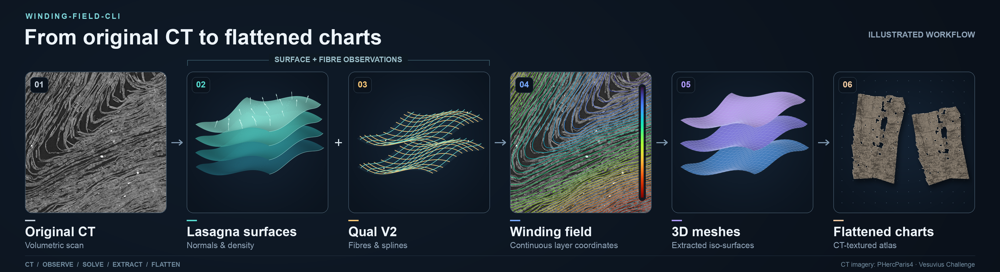

# winding-field-cli

[](https://github.com/LimeGS/winding-field-cli/actions/workflows/tests.yml)
[](#checks)
[](LICENSE)



Build a winding field from scroll CT, then extract meshes and CT-textured surfaces.
Defaults: Lasagna surface observations, Qual V2 fibres/splines, native surface
output with SLIM-optimized local charts. Saved stages let you stop and continue later.
New `run`/`plan` commands use `--device auto`: CUDA → MPS → CPU, admitting an
accelerator only if the core's FP64 vector norm works. The concrete device is
saved before execution; explicit devices and resumed runs are not reselected.
MPS builds without FP64 support are skipped. There is no fallback after starting.

Lasagna output reduction defaults to **cos 2×, grad_mag/nx/ny 4× per axis**.
Use `--lasagna-cos-downsample`, `--lasagna-grad-mag-downsample`,
`--lasagna-nx-downsample`, `--lasagna-ny-downsample` with 1, 2, 4 or 8
(`nx`/`ny` must match). Model input and CT texture stay unchanged; see
[Lasagna grids and recovery](docs/LASAGNA.md#products-units-and-recovery).

Start with **1 → 3** for a small region. Use **1–2** for a full scroll only when
its plan fits your resources; **4** resumes work, **5** exports surfaces,
**6** reuses existing inputs, **7** summarizes options and results, and **8** links
to the detailed guides.

<details>
<summary><strong>1. Install</strong></summary>

Choose quick or manual installation. Both use the same dependencies and automatic
CPU/CUDA selection. For a ready-to-build container, use [Docker](docs/DOCKER.md).

### 1A. Quick install

On **Ubuntu 24.04** with `curl` available, run this in **Bash** from the directory
where you want the checkout:

```bash
source <(script=$(curl -fsSL https://raw.githubusercontent.com/LimeGS/winding-field-cli/main/tools/install.sh) && printf '%s\n' "$script" || printf 'return 1\n')
```

The [installer](tools/install.sh) uses `sudo` for system packages (unless root),
clones into `./winding-field-cli`, creates the CLI and isolated Lasagna environments,
and runs `doctor`, then activates the CLI in this shell. Rerun from the same parent
directory to reuse them. It does not pull updates, reset local edits, download
models or create demo outputs; unrelated
directories and incomplete environments are rejected rather than overwritten.
Review the script before executing downloaded code, or use the manual steps below.

### 1B. Manual install

Run these steps in order.

**A. Clone the checkout and install shared system dependencies (Linux)**

Ubuntu 24.04 (omit `sudo` when running as root):

```bash
sudo apt-get update
sudo apt-get install -y git
git clone https://github.com/LimeGS/winding-field-cli.git
cd winding-field-cli
sudo apt-get install -y $(cat tools/ubuntu-packages.txt)
```

**B. Install the CLI and Lasagna** — bootstrap with Python 3.12 below.
CPU or CUDA is selected automatically from the available hardware and driver.

```bash
python3.12 -m venv .venv
source .venv/bin/activate
python -m pip install --upgrade pip 'uv>=0.9.17'
bash tools/install-runtime.sh
```

The shared recipe installs both environments, including the `plot` and `tifxyz`
Python extras, builds the CLI wheel and checks dependencies. The CLI remains in
`.venv`; Lasagna uses its own Python 3.14.0 environment at
`~/.cache/winding-field/lasagna-venv`. Do **not** activate Lasagna: the CLI finds
it automatically. Existing environments and additional user packages are retained;
model weights download on first use, not during installation.

Docker uses this same recipe and Ubuntu package list, with explicit CPU/CUDA
hash-locked dependency sets and exact Python versions. Host installation resolves
from their shared dependency specifications with automatic backend selection.
Docker additionally bundles native Flatboi and prebuilt accelerators; see
[the installation differences](docs/DOCKER.md#shared-installation-recipe).

**C. Check the installation** — no model downloads:

```bash
winding-field doctor
winding-field demo --output runs/demo
```

The demo uses CUDA when available, otherwise CPU. Open `runs/demo/index.html`.
Use a new output directory for each demo.

</details>

<details>
<summary><strong>2. Run a winding field for a full scroll</strong></summary>

Select the original CT, inspect storage/grid estimates, then run. Replace this
public scan URL with your own URL or local 3D Zarr v2 path as needed.
**No `--roi` means the entire selected CT level.**
At native resolution, this scan's default preparation/product estimate is about
**134 TB**, even with a coarse field. A typical GPU server cannot run this example
unchanged. Use the ROI in section 3 when the plan exceeds available disk; do not
bypass the admission check.

```bash
CT='s3://vesuvius-challenge-open-data/PHerc0175A/volumes/20250521115057-8.640um-1.2m-116keV-masked.zarr'

winding-field plan --source "$CT" --voxel-um 8.64 \
  --field-spacing-um 300 --device cuda:0 --ct-mode stream \
  --until field --output runs/175a-full

winding-field run --source "$CT" --voxel-um 8.64 \
  --field-spacing-um 300 --device cuda:0 --ct-mode stream \
  --until field --output runs/175a-full
```

- `--until field` runs Lasagna → Qual predictions/splines → field, then stops.
- `--field-spacing-um 300` chooses an example coarse solve grid; it does not
  reduce observation preparation or tracing scratch. Check `plan` before running.
- `--ct-mode stream` fetches CT chunks on demand; products still need disk/RAM.
- Use `--device cpu` in both commands for CPU. `plan` does not create the run;
  `run --output` must name a new directory.

**Results:** `field/CHECKPOINT.json` and field blocks, root `FIELD.json` with
geometry/status, `fibres/fibres.afv`, and `lasagna-source/output/` predictions.

For bounded preparation, add `--bounded-preparation` to both commands: recompute
model windows, retain coarse observations and global fibre constraints, and gate
field publication on global numerical verification. Requires `--field-spacing-um`,
Qual V2, stride 1, no custom inputs, and ROI origins divisible by 4.
Add `--fibre-downsample 4` to both commands for a 4× post-prediction fibre grid
instead of the default 2× grid; ROI origins must then be divisible by 8. This uses
about 8× fewer tracing voxels, not less native model inference or CT resolution,
and can lose fine fibres. `plan` reports its physical grid separately.
This trades retained arrays for recomputed context windows: even a small ROI can
be much slower on CPU than the ordinary ROI recipe. Prefer CUDA when available;
no whole-scroll throughput is established. Its endpoint-aligned field grid may
have a slightly different pitch from the requested maximum; inspect `plan`.

Qual requires **uint8, isotropic 8.64–9.6 µm observations**. Set `--voxel-um`
to the actual CT scale and choose `--level`/`--stride` accordingly. Field pitch
is independent: any positive pitch fitting at least two nodes per axis is allowed;
omitting it uses the observation grid, including its anisotropy. Unitless CT
requires `--voxel-um`. Catalog selection uses `--scroll ID --scan ID`; ambiguous
acquisitions need an exact scan or `--source`. `--local /data/mirror.zarr` adds a
matching local chunk mirror to a remote source.

</details>

<details>
<summary><strong>3. Run a field for a specific section of a scroll</strong></summary>

ROI bounds are **selected CT-level voxels**, ZYX, with exclusive upper bounds.
This example requests a 48³ region and a 17 µm field on CPU:

```bash
CT='s3://vesuvius-challenge-open-data/PHerc0175A/volumes/20250521115057-8.640um-1.2m-116keV-masked.zarr'
winding-field run --source "$CT" --voxel-um 8.64 \
  --roi 1488 1536 4032 4080 6048 6096 \
  --field-spacing-um 17 --device cpu --ct-mode stream \
  --until field --output runs/175a-roi
```

Replace the bounds for your region. Use `plan` instead of `run` to inspect grids
first. Inference reads surrounding context; outputs remain inside the ROI.
The field needs at least two nodes per axis.

**Results:** `runs/175a-roi/field/`. To stop earlier, use `--until prepare` for
predictions or `--until fibres` for traced/exported AFV. Continue with
`winding-field field runs/175a-roi`.

</details>

<details>
<summary><strong>4. Stop, inspect and resume a run</strong></summary>

Point `RUN` at the complete run, not its `field/` subdirectory. Press Ctrl-C or
create `STOP` from another terminal, then wait for the process to exit:

```bash
RUN=runs/175a-roi
winding-field status "$RUN"
touch "$RUN/STOP"
```

Use `RUN=runs/175a-full` instead if you admitted and started the full-scroll run.

Continue through field construction or through the selected terminal stage:

```bash
winding-field field "$RUN"
# Or:
winding-field resume "$RUN"
```

Both clear `STOP`, validate saved work and reuse completed stages. A run stopped
at `--until field` reports `PAUSED`; inspect `FIELD.json` for the field result.
Keep the original inputs, runtime, settings and run location. Changed inputs or
implementation require a new output directory.

`resume` finishes native surfaces by default, original mapping for
`--flattening-method original`, atlas for `--surface-output atlas`, or direct
export for `--surface-output tifxyz`. It retains the saved flattening method;
older runs without a method are not switched to SLIM. To extend an exhausted native time budget:

```bash
winding-field resume "$RUN" --extra-surface-seconds 600
```

Already published partial native levels are immutable; extra time does not remap
them. Inspect status and coverage rather than treating a pause as completion.

If a `--bounded-preparation` field exhausted its sweeps without passing global
verification, increase its **absolute total** budget (for example, from 4 to 8):

```bash
winding-field resume "$RUN" --field-sweeps 8
```

This extends the checkpoint budget without changing the original configuration
or discarding progress. Repeating the target adds nothing; lower targets and
changes to published fields are rejected. Verification still gates publication.

</details>

<details>
<summary><strong>5. Extract meshes and flattened CT from an existing field</strong></summary>

### Continue a CLI run

For the default native run from section 2 or 3, continue through rendering:

```bash
winding-field render runs/175a-roi
```

Use `runs/175a-full` for the full-scroll example. This automatically runs any
preceding stages still needed and reuses completed work. Results are under the
run's `surfaces/`: OBJ meshes in `level-*/meshes/` and CT images, overviews and
masks in `level-*/component-*/`. The saved run configuration selects the branch.

New native `run`/`plan` requests default to `--flattening-method slim`: existing
projection/LSCM initialization followed by 10 libigl SLIM iterations per local
chart, with the same geometry gates and seam assembly. Select
`--flattening-method default` for the historical local mapping or `original`
for global LSCM. Base installation includes `libigl==2.6.3` for SLIM; the
`.[tifxyz]` extra adds TIFF export only. No Flatboi is needed. Explicit `slim` is native-only; atlas/direct-field TIFXYZ retain
their previous defaults. See [native flattening](docs/FLATTENING.md#native-run-flattening).

### Export a chosen W level as TIFXYZ

Use the run created in section 3 (or `runs/175a-full` from section 2).
The installer already includes the TIFXYZ dependencies. No configuration files
or repeated CT path/scale are needed:

```bash
winding-field export-sheets --run runs/175a-roi --levels -31 \
  --export-tifxyz --output exports/W-31
```

Choose more levels with `--levels -31 -30`; these are raw field isovalues, as
in the rest of the CLI. The command uses the saved field and CT metadata plus
the original global LSCM recipe. Default XYZ coordinates are physical micrometres
(unit 1, zero origin), not CT voxel indices.

The resolved `field.json` and `flattening.json` are saved automatically in the
export directory and verified on resume; do not edit them. Repeat the same
command with `--resume` to continue. Source runs remain unchanged. Missing or
inconsistent saved metadata produces an error rather than guessed coordinates.

Main outputs:

```text
exports/W-31/original/level-0000/
├── image.png
├── mask.png
└── tifxyz/{x,y,z}.tif
```

`level-0000` means the first requested W (here −31), not W=0.
See [flattening setup and advanced reference](docs/FLATTENING.md) for details.

### Other export workflows

| Task | Command / guide |
| --- | --- |
| Choose LSCM/SLIM and patches/whole sheet | `export-sheets --flattening-solver lscm\|slim --scope patches\|sheet` — [configuration](docs/FLATTENING.md#explicit-solver--scope-matrix) |
| Extract and join continuous W ranges | `extract-range`, `join-ranges` — [recipe](docs/RANGES.md) |
| Align neighbouring W levels on one UV grid | `export-uvw` — [reference map and settings](docs/UVW.md) |
| Prepare, flatten and resume a constant-W sheet | `constant-sheet` — [stages](docs/CONSTANT-SHEET.md) |
| Browse sheets and query pixel XYZ | `sheet-atlas build`, `sheet-atlas query` — [visual atlas](docs/SHEET-ATLAS.md) |
| Continue PNG tiles from a saved patch map | `python -m winding_field.patch_continue` — [required inputs](docs/PATCHES.md#continue-verified-png-tiles) |

All four solver/scope combinations preserve source IDs and support resumable CT/XYZ
export. SLIM needs pinned Flatboi; LSCM does not. Do not mix these flags with
historical `--flattening-method` recipes. UVW outputs are diagnostic: inspect
coverage and deformation before using side cuts through the stack.
SLIM also requires a cgroup v2 memory/swap envelope; a regular unprivileged
container without that host setup cannot run it. These requirements do not apply
to the default native renderer.

Inspect the result, not just the exit code. A completed workflow does not certify
global convergence or physical sheet correctness. Native `PARTIAL` can mean that
requested XYZ cells could not be formed; direct TIFXYZ `BLOCKED` publishes no
READY/PARTIAL delivery. `UVW_EMPTY_DIAGNOSTIC` means no requested level retained
any valid geometry. Black CT pixels can be real acquisition zeros: inspect masks
and coverage rather than treating a saved image as a useful reconstruction.

All CT reads and sampling require the pinned `vc_reader`, installed with the CLI.
Sampling uses verified native float64 interpolation; there is no backend setting.
Resume older reader-bound runs with their original v1.5.0 runtime. See
[supported inputs](docs/STREAMING.md) and [measured performance](docs/RASTER-PERFORMANCE.md).

</details>

<details>
<summary><strong>6. Custom input options</strong></summary>

### Fibres / splines (`.afv`)

An AFV from the **same CT acquisition** skips fibre inference/tracing. Lasagna
still supplies surfaces. Set the ROI to match your data:

```bash
CT='s3://vesuvius-challenge-open-data/PHerc0175A/volumes/20250521115057-8.640um-1.2m-116keV-masked.zarr'
winding-field run --source "$CT" --voxel-um 8.64 \
  --roi 1488 1536 4032 4080 6048 6096 --field-spacing-um 17 \
  --fibres /path/fibres.afv --until field --output runs/from-fibres
```

CLI AFVs carry calibrated coordinates. Otherwise supply `--fibres-geometry
geometry.json` with CT identity, XYZ origin and spacing:
[descriptor](docs/LASAGNA.md#external-afv). V2 names the model; its AFV container
uses schema v1.

### External field (`.npy` or block checkpoint)

For geometry-only extraction, copy and edit the prepared template:

```bash
cp examples/surface-run.example.json surface-run.json
# Replace paths, SHA-256 hashes, geometry, calibration and levels before running.
winding-field prepared surfaces --config surface-run.json --output runs/external-surfaces
```

Paths resolve relative to the JSON. Remove `field.mask` if there is no support
mask. The template's `voxel_um: 8` makes spacing 2 equal to 16 µm; use
`voxel_um: 1` for micrometre origins/spacings. For chunk checkpoints and raw
field-level calibration see [prepared inputs](docs/PREPARED.md#extract-or-import-surfaces-then-render).

**Results:** `level-*.obj` and `renders/*.png` under the output directory. These
are geometry views; original CT/TIFXYZ needs the matching CT and the
[export-sheets recipe](docs/FLATTENING.md).

For several field levels, add `--parallel-levels` to `prepared mesh` or
`prepared surfaces`. CPU, available RAM and disk headroom bound the number of
independent processes automatically. Results are separate `level-0000/`,
`level-0001/`, … bundles indexed by `LEVELS.json`, not a merged mesh.
See [parallel prepared levels](docs/PREPARED.md#parallel-prepared-levels).

### External Lasagna predictions (`.lasagna.json`)

Use existing surface predictions from the **same CT acquisition** to skip Lasagna
inference, its runtime and model download. For example, reuse a CLI export covering
the selected ROI:

```bash
CT='s3://vesuvius-challenge-open-data/PHerc0175A/volumes/20250521115057-8.640um-1.2m-116keV-masked.zarr'

winding-field run --source "$CT" --voxel-um 8.64 \
  --roi 1488 1536 4032 4080 6048 6096 --field-spacing-um 17 \
  --lasagna-input /path/lasagna/surfaces.lasagna.json \
  --until field --output runs/from-predictions
```

The local Lasagna v2 manifest must reference scalar Zarr v2 `cos`, `grad_mag`,
`nx` and `ny` channels. CLI exports include physical geometry; for uncalibrated
predictions, add `--lasagna-geometry lasagna-geometry.json` describing the manifest's
base grid. [Input format and geometry example](docs/LASAGNA.md#external-lasagna-predictions).

Qual still supplies fibres by default. Add `--fibres /path/fibres.afv` (and its
geometry descriptor if needed) to import both inputs without running either
model. Keep the original prediction files for hash-verified resume.

Without explicit or embedded physical geometry, local/HTTP/S3 manifests use the
selected CT base-grid binding and pooled-cell sampling instead. This route also
supports bounded preparation and `resume RUN --offline`; see
[the streaming input contract](docs/LASAGNA.md). Explicit/embedded physical-frame
inputs retain [calibrated interpolation](docs/LASAGNA-CALIBRATED.md).

</details>

<details>
<summary><strong>7. Custom options</strong></summary>

### Options and results at a glance

| Option | Meaning |
| --- | --- |
| `--level` / `--levels` | CT pyramid level / raw field isovalues (`W × sheet_step`) |
| `--stride` / `--field-spacing-um` | Observation sampling / independent solve-grid pitch; bounded preparation uses endpoint-aligned spacing |
| `--lasagna-input FILE` / `--lasagna-geometry FILE` | Import local surface predictions / explicit base-grid calibration; omit `--bounded-preparation` |
| `--surface-output native\|atlas\|tifxyz` | Native default / legacy charts and gallery / experimental direct-field export |
| `--flattening-method slim\|default` | Native local SLIM (new-run default) / historical local mapping |
| `--flattening-method original --flattening-config FILE` | Global LSCM with explicit output frame; independent of field resolution |
| `--export-tifxyz` | Add mesh-derived XYZ TIFFs to native or original renders |
| `--tifxyz-config FILE` | Separate request for the Linux-only experimental direct route |
| `--coverage-target 1 --surface-time-limit 1800` | Native mapped mesh-area target / cumulative active seconds per W |
| `--cache-gib 2 --reserve-gib 1` | CT payload cache cap / free disk reserve, not RAM |
| `--threads 4` | PyTorch threads, not a global worker limit |
| `--device auto` | New-run default: usable CUDA → usable MPS → CPU; explicit PyTorch devices remain supported |
| `--offline` | Disable CT networking; provision models/runtime separately |
| `--invalid-value 0` | Explicitly exclude acquisition fill; otherwise zero CT is valid |

| Output | Where to look |
| --- | --- |
| Saved configuration, status and timings | `RUN.json` |
| Field geometry and solver status | `FIELD.json`, `field/CHECKPOINT.json` |
| Native results and progress | `SURFACES.json`, `surfaces/STATUS.json` |
| Native meshes and CT | `surfaces/level-*/meshes/`, `surfaces/level-*/component-*/` |
| Original global CT/masks/maps | `original/level-NNNN/`, `original/ORIGINAL.json` |
| Atlas-only charts and gallery | `flat/`, `index.html` |
| Direct-field publication | `tifxyz/TIFXYZ.json` and `READY.json` or `PARTIAL.json` |

For complete flags use command-specific help:

```bash
winding-field run --help
winding-field plan --help
winding-field resume --help
winding-field export-sheets --help
winding-field tifxyz --help
winding-field verify-tifxyz --help
```

</details>

<details>
<summary><strong>8. Extra docs</strong></summary>

[Flattening](docs/FLATTENING.md) · [Constant-W visual atlas](docs/SHEET-ATLAS.md) · [Lasagna and AFV](docs/LASAGNA.md) ·
[Streaming](docs/STREAMING.md) · [Prepared workflows](docs/PREPARED.md) ·
[Surface tools](docs/SURFACE_TOOLS.md) · [Attribution](THIRD_PARTY.md)

### Checks

The Audit badge follows installed-package CI pushes on `main`. Coverage is a
local snapshot of this CLI package, not the numerical core's coverage or a live
feed. On **2026-11-08**, the installed-package suite on **macOS arm64 / Python
3.12** passed **1,812 tests**, with **41 skipped** (Linux/CUDA and opt-in external
controls). Statement coverage was **84.01%**: 14,683 of 17,478 statements across
99 Python files, measured with coverage.py 7.17.2. This is not GPU/Docker
qualification. To run the checks from the checkout:

```bash
uv pip install --constraint docker/cli.in '.[test,tifxyz]' pytest-cov
python -m pytest -q --cov=winding_field --cov-report=term-missing
```

</details>

## Credits

Built on tools and open work from the **Vesuvius Challenge community**:

- [Lasagna](https://github.com/ScrollPrize/villa/tree/main/lasagna): surface
  observations and released model checkpoints.
- [Qual AFV fibre V2](https://huggingface.co/Qualzz20/afv_fiber_9um_v2) and
  [AVF Spline Generator](https://github.com/Qualzz/AVF_SPLINE_GENERATOR): fibre
  predictions, tracing and splines.
- [vc_reader](https://github.com/LimeGS/villa/tree/84207424c3a988e6cafe6b50fe7d4d7e5f839929/vc_reader):
  native CT/Zarr access, caching and sampling.
- [Flatboi / VC3D](https://github.com/ScrollPrize/villa/tree/main/volume-cartographer):
  native SLIM flattening and the surrounding surface tools.
- [Villa](https://github.com/ScrollPrize/villa): SD2 model code, AFV/Lasagna/TIFXYZ
  formats and shared community tooling.
- [winding-field](https://github.com/LimeGS/winding-field): numerical field solver;
  [libigl](https://libigl.github.io/) and
  [tifffile](https://github.com/cgohlke/tifffile): geometry and TIFF support.

Thanks to their authors, maintainers and the community publishing scroll data
and models. Exact source pins, adaptations and notices are in
[THIRD_PARTY.md](THIRD_PARTY.md) and [provenance/](provenance/).

## License

[MIT](LICENSE) applies to repository-authored code. External tools, bundled
upstream code, model weights and datasets retain their own licenses and terms;
see [attribution and notices](THIRD_PARTY.md).
