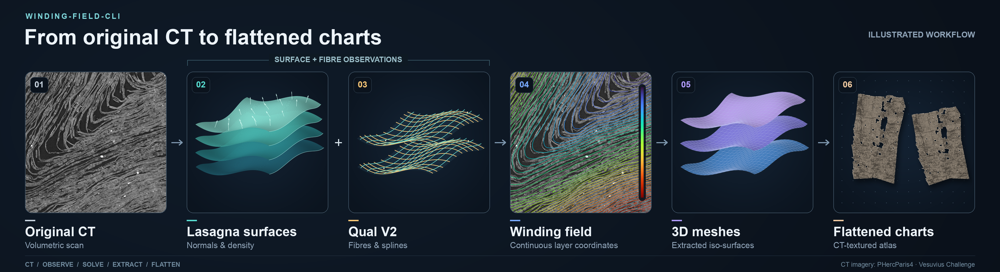

# winding-field-cli


Build a winding field from a scroll's CT, then extract 3D meshes and CT-textured
flat charts. By default, Lasagna supplies surface observations; Qual V2 supplies
fibres and splines. Runs save each stage so you can stop and continue later. Now optimized to run on consumer hardware.

Follow sections **1–2** for a full scroll, or **1 → 3** for a smaller region.
Section **4** covers stopping and resuming; **5** extracts meshes; **6** covers
inputs you already have.

<details>
<summary><strong>1. Install</strong></summary>

**CLI and numerical library.** Requires Python **3.11 or 3.12**, Linux/macOS.
Run these commands in a terminal; keep the virtual environment active for the
examples below. Substitute `python3.12` for `python3.11` if needed.

```bash
git clone https://github.com/LimeGS/winding-field-cli.git
cd winding-field-cli
python3.11 -m venv .venv
source .venv/bin/activate
CORE_REV=$(python -c "import json; print(json.load(open('provenance/core.json'))['revision'])")
python -m pip install \
  "winding-field-experiments @ https://github.com/LimeGS/winding-field/archive/$CORE_REV.tar.gz" .
winding-field doctor
```

**Lasagna runtime.** Default CT runs also need the official Lasagna package. It uses
Python 3.14 in a separate environment; install it once without activating it:

```bash
python -m pip install uv
uv python install 3.14
uv venv --python 3.14 ~/.cache/winding-field/lasagna-venv
uv pip install --python ~/.cache/winding-field/lasagna-venv/bin/python \
  'vesuvius-lasagna @ https://github.com/ScrollPrize/villa/archive/b29f310957c7b29e7d332f9876e0e487819cfaa3.tar.gz#subdirectory=lasagna'
```

The CLI finds this runtime automatically. Lasagna and Qual weights download on
first use. For CUDA, both environments need a compatible CUDA-enabled PyTorch:
[runtime setup](docs/LASAGNA.md#one-time-runtime-setup).

**Optional installation check:** run the synthetic pipeline offline, without
model downloads, then open `runs/demo/index.html` in a browser:

```bash
winding-field demo --output runs/demo
```

</details>

<details>
<summary><strong>2. Run a winding field for a full scroll</strong></summary>

Select the original CT volume. This example uses the public PHerc0175A scan;
you can replace its URL with a local 3D Zarr v2 path. **No `--roi` means the entire
selected CT level.**

First inspect geometry and storage estimates with `plan`, then start the run:

```bash
CT='s3://vesuvius-challenge-open-data/PHerc0175A/volumes/20250521115057-8.640um-1.2m-116keV-masked.zarr'

winding-field plan --source "$CT" --voxel-um 8.64 \
  --field-spacing-um 300 --device cuda:0 --ct-mode stream \
  --until field --output runs/175a-full

winding-field run --source "$CT" --voxel-um 8.64 \
  --field-spacing-um 300 --device cuda:0 --ct-mode stream \
  --until field --output runs/175a-full
```

- `--until field` runs Lasagna → Qual predictions/splines → field, then stops.
- `--field-spacing-um 300` selects an example **coarse 300 µm solve grid**.
  Choose your field resolution here; it does not reduce observation preparation.
- `--ct-mode stream` fetches CT chunks as needed. Prediction products and tracing
  scratch still need disk/RAM; inspect the estimates before a whole-scroll run.
- `--device cuda:0` uses the first GPU. Use `--device cpu` in both commands for CPU.
- `--output` must be a **new directory**. `plan` does not create the run.

**Results:** `runs/175a-full/field/` holds the field and `CHECKPOINT.json`;
`FIELD.json` records geometry and solver status. `fibres/fibres.afv` retains the
splines, and `lasagna-source/output/` retains Lasagna predictions.

The default Qual model requires **uint8, isotropic 8.64–9.6 µm observations**.
For another acquisition, set `--voxel-um` to its actual spacing and choose
`--level` / `--stride` accordingly. Field spacing is independent of CT spacing.

</details>

<details>
<summary><strong>3. Run a field for a specific section of a scroll</strong></summary>

Add `--roi Z0 Z1 Y0 Y1 X0 X1` to limit the output to a region. Bounds are in
**voxels of the selected CT level**, with exclusive upper bounds. This example
selects a **48 × 48 × 48 voxel** region and solves a **17 µm field** on CPU:

```bash
CT='s3://vesuvius-challenge-open-data/PHerc0175A/volumes/20250521115057-8.640um-1.2m-116keV-masked.zarr'

winding-field run --source "$CT" --voxel-um 8.64 \
  --roi 1488 1536 4032 4080 6048 6096 \
  --field-spacing-um 17 --device cpu --ct-mode stream \
  --until field --output runs/175a-roi
```

- Replace the six bounds to select your region; use `plan` instead of `run` to
  inspect its grids first. Inference reads context around the ROI, but the output
  stays inside it.
- Choose `--field-spacing-um` independently of the CT resolution. The ROI must
  contain at least two field nodes per axis.
- Results are in `runs/175a-roi/field/`. Use this run path in sections 4 and 5.

To create intermediate inputs from scratch, replace `--until field` with
`--until prepare` for Lasagna + Qual predictions, or `--until fibres` to also trace
and export `fibres/fibres.afv`. Continue that same run with `winding-field field RUN`.

</details>

<details>
<summary><strong>4. Stop, inspect and resume a run</strong></summary>

Point `RUN` at the run directory, not its `field/` subdirectory. While a job is
running, press **Ctrl-C** or create `STOP` from another terminal. It saves
committed work and stops at a bounded operation; wait for the process to exit.

```bash
RUN=runs/175a-full
winding-field status "$RUN"               # stage status, timings and saved settings
touch "$RUN/STOP"                         # request a checkpointed stop
```

After it exits, choose how far to continue:

```bash
# Continue only through field construction:
winding-field field "$RUN"

# Or continue all the way through meshes and flattened charts:
winding-field resume "$RUN"
```

Both commands clear `STOP`, validate saved work and reuse completed stages. A
run intentionally stopped with `--until field` reports `PAUSED`; check `FIELD.json`
for its field result. Keep the original inputs, saved settings and runtime.
Use a new output directory to change them.

</details>

<details>
<summary><strong>5. Extract meshes from an existing field</strong></summary>

For a field produced in section 2 or 3, use its complete run directory. The
saved field is reused; completed inference and solving stages are not rerun.

```bash
RUN=runs/175a-roi                         # or runs/175a-full
winding-field mesh "$RUN"
```

**Result:** `meshes/level-*.obj`, one 3D mesh per selected isovalue. Isovalues are
automatic unless you pass `--levels 1 2 3` when creating the run.

To also generate UV charts, flat OBJ files and original-CT previews:

```bash
winding-field flatten "$RUN"
```

Results are in `flat/`; open the run's `index.html` to browse them.
For a standalone field created elsewhere, use the external-field recipe below.

</details>

<details>
<summary><strong>6. Custom input options</strong></summary>

### Fibres / splines (`.afv`)

Use an existing AFV with the **same CT acquisition** to skip Qual inference and
tracing. Lasagna still supplies the surface observations. Set the fibre path and
ROI to match your data; this example uses the region from section 3:

```bash
CT='s3://vesuvius-challenge-open-data/PHerc0175A/volumes/20250521115057-8.640um-1.2m-116keV-masked.zarr'

winding-field run --source "$CT" --voxel-um 8.64 \
  --roi 1488 1536 4032 4080 6048 6096 --field-spacing-um 17 \
  --fibres /path/fibres.afv --until field --output runs/from-fibres
```

CLI-exported AFVs include their calibrated coordinates. If yours lacks that
metadata, also pass `--fibres-geometry geometry.json` with the CT source, XYZ
origin and spacing: [geometry descriptor](docs/LASAGNA.md#external-afv).

### External field (`.npy` or block checkpoint)

Extract surfaces directly from an existing field using a prepared recipe. This
route needs the field and its geometry; it does not run CT inference or solve a
new field.

Copy the template:

```bash
cp examples/surface-run.example.json surface-run.json
```

Edit `surface-run.json` before running; input paths are relative to this JSON
unless absolute:

- Set `field.path` and replace its placeholder SHA-256 with the file's hash.
- Set the `field.mask` path/hash to your support mask, or remove this optional
  entry if your field has no mask.
- Set `geometry` to the field's frame, origin, XYZ spacing, ZYX shape and calibration.
- Set `levels` to the raw field values you want to extract.
- For a frozen native block field, replace the `field` object with
  `{"kind":"chunks","path":"/path/field/CHECKPOINT.json","sha256":"…","support_policy":"observed"}`.

Then extract meshes and geometry views:

```bash
winding-field prepared surfaces --config surface-run.json --output runs/external-surfaces
```

**Results:** `runs/external-surfaces/level-*.obj` and `renders/*.png`.
These PNGs show geometry; CT-textured export needs a matching CT source.
[Field recipe details](docs/PREPARED.md#extract-or-import-surfaces-then-render)
· [CT-textured export](docs/SURFACE_TOOLS.md#export-and-atlas)

### External Lasagna predictions — Coming soon

Importing precomputed `.lasagna.json` / OME-Zarr predictions into a new run is
not available yet. Current runs generate Lasagna predictions automatically and
reuse them when resumed. `--lasagna-model-path` selects model weights, not
prediction files.

</details>

All CLI options: `winding-field run --help`.

[Formats](docs/FORMATS.md) · [Lasagna and AFV](docs/LASAGNA.md) · [Streaming](docs/STREAMING.md) ·
[Prepared workflows](docs/PREPARED.md) · [Surface tools](docs/SURFACE_TOOLS.md) ·
[Attribution](THIRD_PARTY.md)

Research output: physical sheet correctness and global convergence remain unvalidated.
