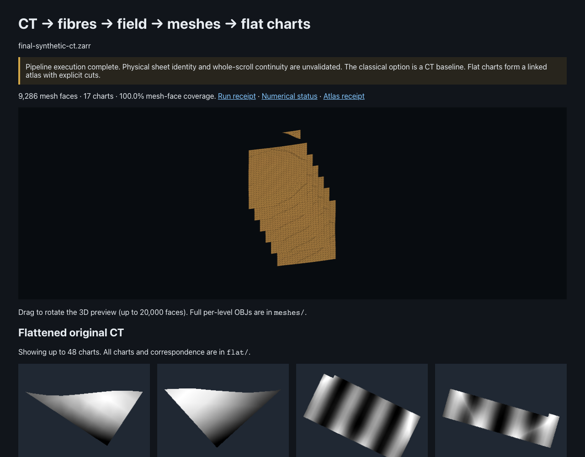
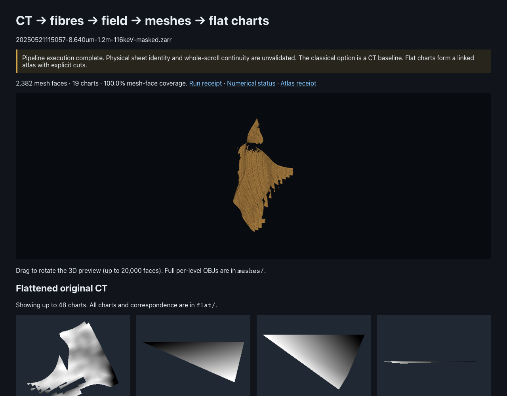

# Release verification

This directory retains reference receipts and browser screenshots from the installed
CLI. They establish execution, exported mesh coverage and tested packaging; they
do not establish physical sheet accuracy or whole-scroll reconstruction.

Reference runs use original S3 PHerc0175A CT with pinned SD2, and synthetic curved
CT with the labelled classical baseline. Exact commands are in [DEMO.md](../DEMO.md).
Machine-local paths in copied run receipts identify the original verification
environment and are not commands to resume on another machine.

The real-CT samples are derived from the Vesuvius Challenge PHerc0175A acquisition
(`20250521115057-8.640um-1.2m-116keV-masked`, as listed in the public catalog).
Dataset terms: CC BY-NC 4.0. Code licensing does not relicense these CT images.

## Measured reference runs

| Installed CLI run | Fibre fragments | Mesh faces | Flat charts | Mesh-face coverage |
| --- | ---: | ---: | ---: | ---: |
| Synthetic curved CT, classical | 95 | 9,286 | 17 | 100% |
| Original PHerc0175A ROI, SD2 | 26 | 2,382 | 19 | 100% |

The initial real run's [S3 receipt](initial-S3-RUN.json) includes 6,291,456 newly
downloaded bytes from a partially warm cache. The installed-package rerun used
that cache and transferred zero new CT payload bytes. Neither is a cold-network
benchmark. Receipt names start with `release-synthetic` or `release-175a-sd2`
and describe the final `runs/final-*` demonstrations.

The clean environment had no inherited site-packages. All **39 tests passed in
56.71 s** with
the wheel installed and `pythonpath` disabled, from a working directory outside
the checkout. Both installed demos and their resumes completed; both resumes
preserved checkpoint, mesh and atlas receipt hashes. Dependency and browser
details are in [environment.json](environment.json).

```bash
# From outside the checkout, with the wheel and pytest installed in a fresh venv:
OMP_NUM_THREADS=4 /path/to/venv/bin/python -m pytest /path/to/checkout/tests -q -o pythonpath=
```

The [independent review](REVIEW.md) identified eight important issues, all fixed
with failing-then-passing regressions before these final runs. An actual S3 local
mirror was also [verified without downloading its payload again](local-mirror.json).
The galleries rendered in Chromium with loaded CT images, working drag rotation
and no JavaScript errors; the final screenshots are below.

### Synthetic demo



### Original-CT demo


